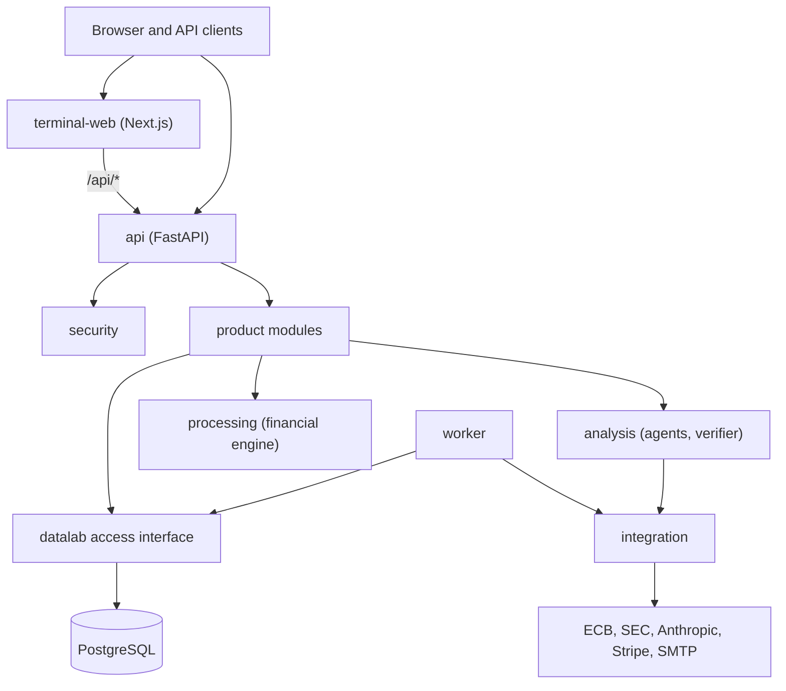

# Architecture

AUREX is a layered modular system delivered as one versioned artifact (ADR-0001, ADR-0002). The same
image runs as the API, the worker and the migration job; the web terminal is a separate image that uses
only the public API.

## Layers

| Layer | Packages | Responsibility |
|---|---|---|
| System interface | `interface/api`, `interface/terminal-web` | REST API (FastAPI) and the web terminal (Next.js). Request validation, sessions, error rendering. |
| Pipeline | `pipelines` | Bootstrap (migrations, security policies, seeds), job queue, worker with scheduler. No business logic. |
| Security | `security` | Identity, sessions, API keys, roles, plans and entitlements, usage limits, rate limits, content screening, billing state. |
| Product modules | `modules/markets`, `intelligence`, `portfolio`, `quant`, `graph`, `datalab` | The six product modules. |
| Platform modules | `modules/analysis`, `processing`, `integration`, `validation`, `logging` | AI orchestration, the financial engine, outbound connectors and model adapters, boundary validation, logs and audit. |
| Core | `core` | Configuration, canonical models, error model, money, database primitives, entitlement vocabulary. |

## Dependency rules (checked in CI by import-linter)

1. Dependencies point downward through the layers above. Product modules are siblings and do not import
   each other, with one published exception: Intelligence reads Markets, Portfolio and Graph.
2. Product modules reach shared data only through `modules.datalab.access`; DataLab's tables and ingestion
   code are off limits to them.
3. Only `modules.integration` imports network clients (`httpx`, `anthropic`, `stripe`, `smtplib`, `socket`).
4. The financial engine (`modules.processing`) imports no database or network code.

Where two product modules must be combined (a Monte Carlo run on a portfolio), the API layer composes them.

## Runtime

| Process | Command | Scaling |
|---|---|---|
| API | `uvicorn interface.api.main:app` | Stateless. The rate limiter is per process; run one process per host or enforce limits at the proxy. |
| Worker | `python -m pipelines.worker` | Two lanes: interactive (AI answers) and background (imports, schedule). Several workers can share the queue (`FOR UPDATE SKIP LOCKED`). |
| Migration | `python -m pipelines.bootstrap` | Idempotent; runs before the API and worker start. |
| Web | `node server.js` (standalone) | Stateless. |

Storage is PostgreSQL only (ADR-0005): system of record, full-text search, job queue and audit trail. No
cache or broker is needed at the current scale; the extraction criteria in ADR-0002 say when to add one.

## Tenancy

Every tenant-private table carries `tenant_id` and a row-level security policy. A request session runs as
the unprivileged `aurex_app` role with `app.tenant_id` set, so a missing filter in application code still
cannot return another organization's rows (ADR-0008). Shared reference data (`tenant_id IS NULL`) is
readable by all and writable by none from a request session.
