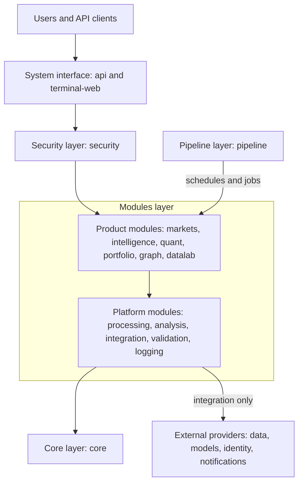
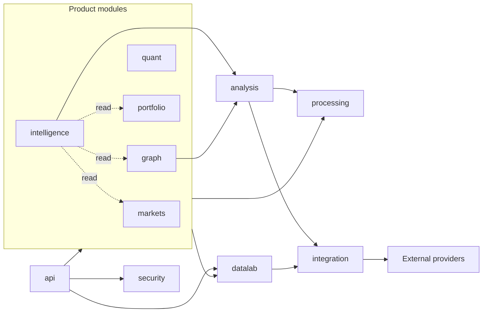
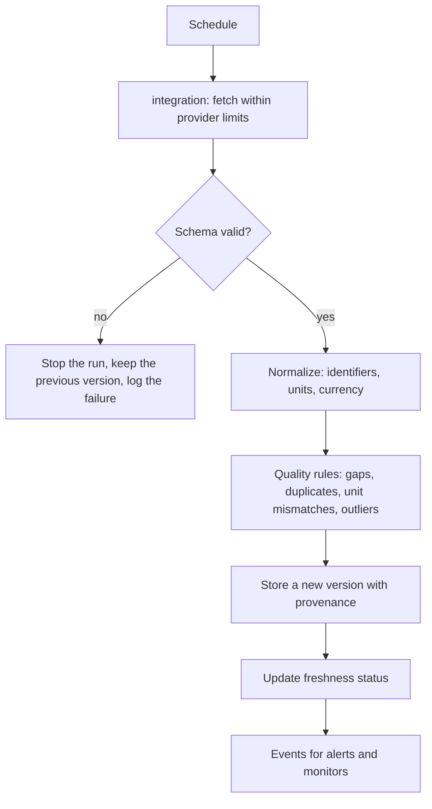
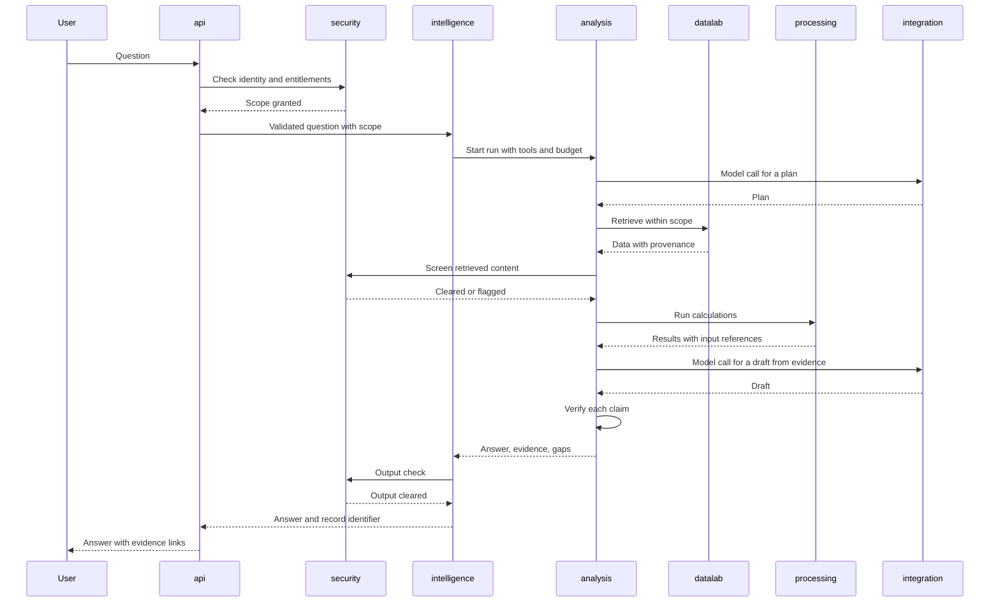
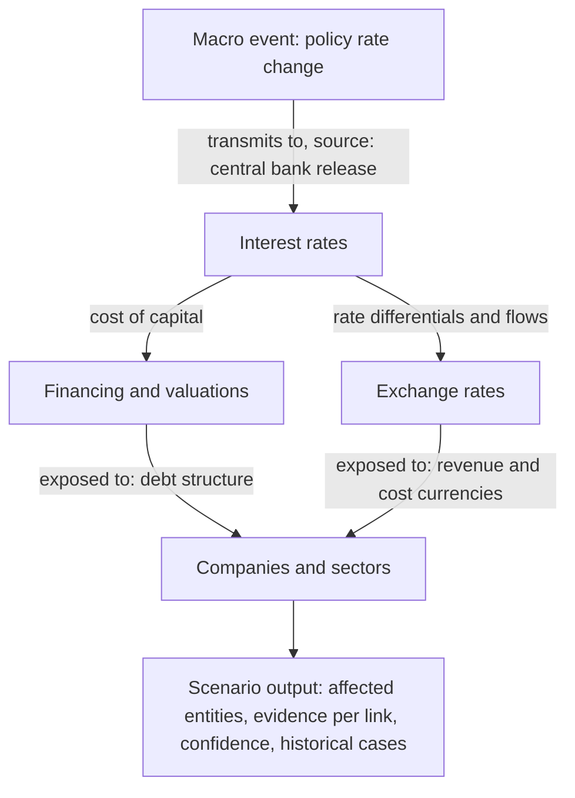
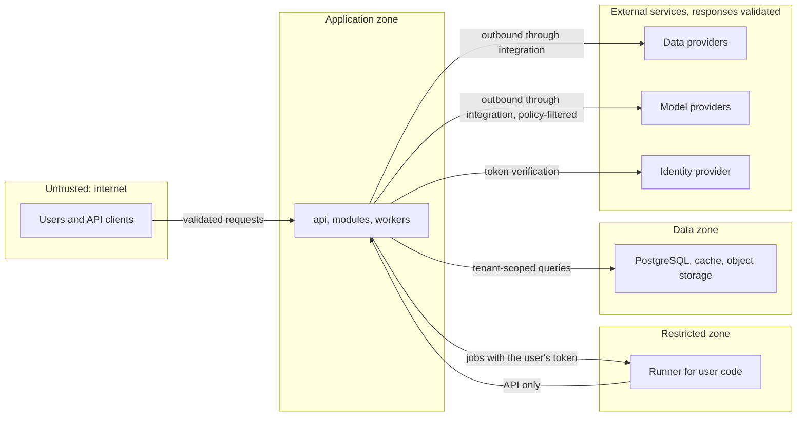
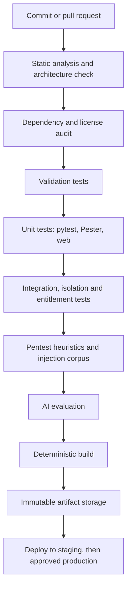

# AUREX — AI Financial Intelligence Platform

**Project definition and target architecture**

| Field | Value |
|---|---|
| Status | Proposed, for owner review |
| Version | 0.1 |
| Date | 2026-11-10 |
| Inputs | Source concept chat "Projekt: Bloomberg Terminal nowej generacji" (working name AUREX); standards in the `COPILOT-PROMPTS` repository |
| Content | Text, tables and Mermaid diagrams. No application code. |
| Next action | Owner decisions listed in section 7.7 |

Names in code font (`markets`, `datalab`) are repository modules. "AUREX Markets", "AUREX DataLab" and similar are the product names from the source concept. A tenant is one customer account, either an individual user or an organization.

## 0. How the repository prompts were applied

| Standard | Applied as | Sections |
|---|---|---|
| `copilot-instructions.md` | Layered architecture, naming rules, zero trust, CI/CD and documentation rules; plan before implementation | All |
| `architecture.prompt.md`, `architecture.agent.md` | Output order: Analysis, Plan, Implementation, Documentation updates, Validation; a reason for each design choice; Mermaid diagrams | 2 to 7 |
| `documentation.prompt.md`, `documentation.agent.md` | Summary, cross-references, technical tone, lists and tables | 1, 6, 8 |
| `refactor.prompt.md` | The source concept is the object being restructured: goal, affected files, tests, documentation, risks, validation plan | 3.3, 3.6, 5, 6, 7 |
| `pentest.agent.md`, `docs/security.md`, `docs/pentest-flow.md` | Threat model, heuristics, risk levels | 7.2, 7.3 |
| `ADR-0001-core-architecture.md` | Authoritative layer model; extended, not replaced | 3.4, 4.2 |
| `docs/modules.md`, `docs/data-flow.md`, `docs/validation.md`, `docs/logging.md`, `docs/ci-cd.md` | Module roles, standard data flow, error and log schemas, pipeline stages, coverage thresholds | 4, 5, 7.4 |

No files were changed. This document is the plan that the standards require before any implementation.

## 1. Summary

- **Product.** AUREX is a professional financial terminal: one environment for market data, research, quantitative modeling, portfolio risk and relationship analysis. AI supports the analyst and does not replace the analyst's judgment.
- **Scope.** Six product modules (Markets, Intelligence, Quant, Portfolio, Graph, DataLab) on one data model and one search service.
- **Meaning of "better than Bloomberg".** AUREX does not try to match Bloomberg on licensed real-time data, the messaging network or trade execution. It targets properties that can be tested: verifiable AI answers, reproducible research, visible data freshness and license status, full programmatic access, and flexible deployment and pricing (section 3.2).
- **Changes to the source concept.** The product idea is kept. Three things change. The concept is mapped onto the repository's layered architecture and zero-trust rules. Provenance, tenant isolation, audit and point-in-time storage move to Stage 1, because they cannot be added later without rework. Each stated principle (evidence, agent permissions, data licenses) gets an enforcement mechanism (section 3.3).
- **State.** Nothing is implemented. The order of work is: owner decisions (section 7.7), the first seven ADRs, Stage 1 (section 3.5).

## 2. Analysis

### 2.1 Inputs

| Input | Content | State |
|---|---|---|
| Source concept | Product idea, six modules, AI functions, technical architecture, stack, data sources, four-stage plan, business model, security principles | Concept only. It ends with an open question: where the project will be built. |
| Repository standards | `copilot-instructions.md`, three agent definitions, three prompts, ADR-0001, thirteen documents in `docs/` | Standards and documentation only. No application code. |
| Market facts | Pricing and AI features of the reference product; license terms of proposed components and data sources | Checked on 2026-11-10. Sources in section 8.2. |

### 2.2 Source concept

| Product module | Role in the concept | Scope |
|---|---|---|
| AUREX Markets | Data and monitoring | Equities, ETFs, indices, bonds, currencies, commodities, crypto-assets, macroeconomic indicators; shared watchlist; interactive charts; event calendar; price alerts; cross-asset correlations |
| AUREX Intelligence | Reasoning and research | Questions in natural language; analysis of financial statements; document search; company comparison; news synthesis; answers backed by sources |
| AUREX Quant | Modeling | Backtesting on historical data; factor analysis; Monte Carlo simulation; stress tests; volatility studies; Python notebooks |
| AUREX Portfolio | Portfolio and risk | Virtual portfolios; transaction history; performance after costs; currency exposure; concentration; drawdown; benchmarks; what-if scenarios |
| AUREX Graph | Relationships | Links between companies, suppliers, customers, industries, commodities and economies |
| AUREX DataLab | Integration and automation | Provider connectors; ingestion schedules; quality validation; instrument normalization; data versioning; API for the other modules |

The concept also defines:

- **Research Copilot.** A four-step answer: acquire data with metadata; calculate in a controlled engine; verify every conclusion against a source; report with data gaps and scenarios.
- **Six agents.** Research, Earnings, Macro, Risk, Data Quality, Thesis Monitor, each with limited tools and permissions.
- **Market Impact Graph.** A chain of possible consequences from a macroeconomic event to companies and sectors. Every link has a source, a relation type and a confidence level. Hypotheses are not shown as forecasts.
- **Architecture.** API-first; runs locally, on the customer's server or in the cloud; a modular monolith first, separate services only where scaling requires them.
- **Stack.** Next.js, React, TypeScript; FastAPI, Pydantic; PostgreSQL with TimescaleDB or partitioning; Redis; S3-compatible storage; PostgreSQL full-text search with pgvector; Celery or Dramatiq; model adapters; Docker Compose, later Kubernetes; OpenTelemetry, Prometheus, Grafana.
- **Data sources.** SEC EDGAR, Financial Modeling Prep, European Central Bank; licensed data later.
- **Plan.** Four stages with priorities P0, P0, P1, P2. The durations add up to 11 to 20 weeks for one developer assisted by AI, and the concept marks them as indicative.
- **Business model.** Five plans: Community, Pro, Quant, Business, Enterprise. Prices are not set.
- **Security.** Eight principles, including tenant isolation, audit, prompt-injection protection and no automatic trade execution.

### 2.3 Reference market

"Bloomberg-class" means the capability set in the table below. Three facts shape the plan.

1. **Price.** Bloomberg does not publish Terminal prices. Third-party trackers report about USD 24,000 to 32,000 per seat per year, usually on a two-year contract. One tracker lists USD 31,980 for a single seat and USD 28,320 per seat on multi-seat contracts, with data feeds priced separately.
2. **AI.** In February 2026 Bloomberg announced ASKB, a conversational interface for the Terminal built on coordinated agents, in beta at the time. It answers with source attribution and returns the underlying BQL query for data analysis. Reporting from October 2026 says access is being extended from the beta group to all subscribers (about 375,000 seats) and that clients can upload their own documents. Cited AI answers are therefore not a differentiator on their own.
3. **Other references named in the concept.** LSEG Workspace is reported at USD 12,000 to 24,000 per user per year, and FactSet at USD 12,000 to 40,000 or more per seat per year. TradingView is the reference for chart interaction, and its open-source chart library is part of the proposed stack. At the low end of the market, Koyfin lists plans from free to USD 299 per month.

All prices except Koyfin's are unofficial reported figures.

| Capability | Bloomberg-class terminal | AUREX position | AUREX module |
|---|---|---|---|
| Market data | Licensed real-time and historical data across asset classes | Historical, delayed and public data first, always labeled; licensed real-time data only under contract | `markets`, `datalab` |
| News | Own newsroom plus aggregated sources | Licensed and public sources and filings; no newsroom | `intelligence` |
| Analytics | Large function catalog driven by keyboard commands | Focused catalog; commands plus semantic search; user-defined indicators | `markets`, `processing` |
| Screening | Filtering of instruments by fundamental and price criteria | Not in the source concept; proposed for `markets` (decision 10 in section 7.7) | `markets` |
| Portfolio and risk | Integrated portfolio analytics | Virtual portfolios, exposures, drawdown, scenarios | `portfolio` |
| Quantitative tools | Query language and hosted notebooks (BQL, BQuant) | Python notebooks; backtests with explicit assumptions | `quant` |
| AI assistant | ASKB: agent-based, cited answers, generated BQL, client documents | Evidence ledger, reproducible calculations, choice of external or local models | `intelligence`, `analysis` |
| Relationship analysis | Supply-chain and peer data | Market Impact Graph with typed, sourced, confidence-rated links | `graph` |
| Messaging network | Instant Bloomberg | Out of scope; sharing of analyses inside a team only | none |
| Trade execution | Order and execution management | Out of scope | none |
| Programmatic access | Separately priced data feeds and APIs | API-first; export subject to the license register | `api`, `datalab` |
| Deployment | Vendor-operated service | Local, self-hosted or cloud | `pipeline` |
| Cost | Reported USD 24,000 to 32,000 per seat per year | Modular plans; prices set after cost analysis | none |

The source concept already states the limit: AUREX cannot match Bloomberg on licensed data, the contact network or institutional infrastructure. The plan accepts those gaps and competes elsewhere (section 3.2).

### 2.4 Findings against the repository standards

| ID | Finding | Standard | Impact |
|---|---|---|---|
| F-01 | The concept calls the deployment a "modular monolith". ADR-0001 rejects "monolithic architecture" and "microservices" and adopts a layered modular architecture. The intent is compatible; the terms conflict. | ADR-0001 | Agents that treat ADR-0001 as authoritative may reject the design. |
| F-02 | The six product modules and the four engines (financial, AI, data pipeline, control) are not mapped to the standard layers or to the standard module roles (Processing, Analysis, Validation, Logging, Integration, Security, Pipeline). | `copilot-instructions.md` §3.1; `docs/modules.md` | Boundaries and dependencies are undefined. |
| F-03 | The "control engine" combines data quality, permissions, audit and risk limits. These belong to different modules. | `docs/modules.md` §1 | One component with four responsibilities; cross-module coupling. |
| F-04 | The stack adds TypeScript. The standards define languages, naming and test tools for PowerShell and Python only. | `copilot-instructions.md` §1.1, §3.2, §5.1 | No naming or test standard for the web terminal. The role of PowerShell is undefined. |
| F-05 | Validation and sanitization stages are not placed in the data flow. Provider payloads, uploaded files, documents and model output are all untrusted. | `docs/data-flow.md`; `docs/validation.md` | Raw input could reach processing or logs. |
| F-06 | Agent restrictions are a principle without an enforcement model. | `docs/security.md` §1; `docs/agent-safety.md` | Prompt injection could expose data or trigger unwanted actions. |
| F-07 | The evidence requirement has no data structure and no acceptance test. | `docs/validation.md` §1 | The main differentiator cannot be verified. |
| F-08 | License rules are a principle. Nothing prevents restricted data from being displayed, exported or sent to a model. | `docs/security.md` §1 | Risk of breaching provider contracts. |
| F-09 | Tenant isolation and audit are listed as principles, but the plan schedules organization management, audit and usage limits in Stage 4. | `docs/security.md`; `docs/logging.md` | Adding isolation and audit after three stages means rewriting data access. |
| F-10 | Backtesting is planned, but there is no rule for storing data as it was known at each point in time. | `docs/architecture.md` §1 | Look-ahead and survivorship bias. History that was overwritten cannot be rebuilt. |
| F-11 | Notebooks and user scripts execute user-supplied code. Isolation is not defined. | `pentest.agent.md` §3 | The largest attack surface in the product. |
| F-12 | Observability tools are named. The log schema, the forbidden data list and the audit trail rules are not applied. | `docs/logging.md` | Sensitive data in logs and traces. |
| F-13 | Tests are mentioned without coverage thresholds, CI gates or a method for evaluating AI output. | `docs/ci-cd.md` §5.3 | Quality gates cannot block a release. |
| F-14 | Graph links need a source, a type and a confidence level, but nothing defines how links are created, reviewed and displayed. | `docs/agent-safety.md` §1 | Unverified links could appear as analysis. |
| F-15 | The stage estimates exclude the documentation, test and pentest gates required by the standards. | `copilot-instructions.md` §2.2, §5 | The schedule is underestimated. |
| F-16 | Cited AI answers are treated as the main advantage. The reference product now offers them too (section 2.3). | Market fact | Citations alone no longer differentiate. |

### 2.5 Zero-trust posture of the source concept

| Untrusted input | Covered by the source concept |
|---|---|
| Provider payloads | Yes: validation, duplicate detection, gap marking |
| User requests through API and WebSocket | Not stated |
| Uploaded files (portfolio imports, documents) | Not stated |
| Documents and news used by AI | Yes: prompt-injection protection |
| Language model output | Partly: figures come from a controlled engine |
| User code (notebooks, scripts, indicators) | No |
| Connector and notification configuration | Partly: secret management |
| Build inputs (dependencies, pipeline configuration) | No |

Sections 4 and 7.2 define a control for every row.

## 3. Plan

### 3.1 Product definition

**Purpose.** One environment for acquiring data, verifying information, analyzing scenarios and preparing decisions. A user should not need several platforms, spreadsheet exports and manual reading of many documents to understand a market event and its consequences.

**Users and plans** (from the source concept):

| Plan | Audience | Scope |
|---|---|---|
| Community | Students and people learning analysis | Demonstration data, basic charts, limited AI |
| Pro | Analysts and independent researchers | AI research, alerts, reports, own dashboards |
| Quant | Python users and modeling teams | Backtesting, notebooks, export, API |
| Business | Small analytical teams | Shared analyses, permissions, audit |
| Enterprise | Financial institutions | Integrations, access control, service levels, licensed data |

Prices are set only after the costs of data, models, infrastructure and support are known and willingness to pay has been tested.

**Goals.**

1. A user answers a research question inside the terminal, with data, documents, calculations and evidence in one place.
2. Every number has a known origin, age and license status.
3. Every AI answer can be checked and reproduced.
4. Every function of the interface is available through the API.
5. The same build runs locally, self-hosted and in the cloud.

**Non-goals.**

- No order routing or trade execution. Such a function would be a separate project with its own security design and legal analysis.
- No personalized investment advice and no buy or sell recommendations.
- No own newsroom and no messaging network.
- No real-time exchange data until a license covers it.
- No pursuit of large investment banks in the first stages.

### 3.2 Definition of "better": criteria that can be tested

| Area | Approach from the source concept | Acceptance criterion added by this plan |
|---|---|---|
| Usability | Visual interface, semantic search, keyboard commands | Every function is reachable by menu, by command and by search. A new user completes five core tasks (find an instrument, chart it, add it to a watchlist, ask a question, open the evidence) without documentation. |
| AI | Answers based on data and evidence, with stated uncertainty | Every figure in an answer comes from the financial engine or from a cited source field. Every factual statement links to evidence or is labeled as an assumption. Stale and missing inputs are listed. Measured on a fixed evaluation set before each release. |
| Data | One model for all providers; explicit freshness control | No value is stored or shown without source, time fields, unit, currency where relevant, freshness class and license class. |
| Research | Automated reports with source history and reproducible calculations | Re-running a stored report against its recorded data versions returns identical figures. |
| Quant | Backtests that include costs, delays and overfitting risk | A backtest does not run without cost and latency assumptions. It uses only data known at the simulated time. It reports out-of-sample results and the number of variants tried. |
| Personalization | Own dashboards, scripts, indicators, workflows | Workspaces, indicators and workflows are saved per user or team and can be exported as files. |
| Integrations | API, data export, Python | The web terminal uses only the public API. Anything visible in the interface is retrievable through the API when the license allows it. |
| Cost | Modular plans instead of one institutional package | Plans are entitlement sets on one build. A tenant can enable one module without the others. |
| Deployment | Local, self-hosted or cloud | One artifact runs in all three modes. Restricted data can stay on infrastructure the customer controls, including model inference with local models. |

### 3.3 Changes to the source concept

**Goal of the restructuring.** Keep the product idea, make it conform to ADR-0001 and the zero-trust rules, and make each stated principle enforceable by the system.

| ID | Change | Reason | Resolves | Specified in |
|---|---|---|---|---|
| C-01 | Describe the system as a layered modular architecture delivered as one deployable artifact, with boundaries enforced by automated checks and written criteria for extracting services. | Keeps the low cost of a single deployment and stays consistent with ADR-0001. | F-01 | 4.2, 4.12, ADR-0002 |
| C-02 | Place the six product modules in the Modules layer. Split the four engines across the standard module roles. Dissolve the "control engine" into `security`, `validation`, `logging` and portfolio rules. | One responsibility per module. | F-02, F-03 | 4.2 to 4.4 |
| C-03 | Add TypeScript to the standards by ADR, with naming and test rules. Keep PowerShell for operations scripts so that Pester stays in use. | The standards must cover every language in the repository. | F-04 | ADR-0003, 4.13, 5 |
| C-04 | Place validation and sanitization at every boundary: ingestion, API, module interfaces, AI context assembly, output. | Zero trust; no raw input downstream. | F-05 | 4.6 |
| C-05 | Move provenance, license class, tenant identifier, audit events and point-in-time storage to Stage 1. | These are properties of the data model. Adding them later means migrating all data and rewriting access paths. | F-09, F-10 | 3.5, 4.5 |
| C-06 | Add an evidence ledger, a claim verification step and an evaluation suite that gates releases. | Turns "answers with sources" into a testable property. | F-07, F-13, F-16 | 4.7, 5 |
| C-07 | Add a tool registry with allow-lists per agent, user-scoped data access, budgets and confirmation for actions with side effects. | Least privilege for agents. | F-06 | 4.7 |
| C-08 | Add a license register and entitlement checks at ingestion, retrieval, AI context assembly and output. | License terms are enforced by the system, not by convention. | F-08 | 4.11 |
| C-09 | Define an isolated runtime for user code before notebooks are built. Start with declarative indicators evaluated by the financial engine. | Arbitrary code runs only in a sandbox designed for it. | F-11 | 4.3, 4.12, ADR-0009 |
| C-10 | Add link governance to the Graph: mandatory attributes, creation paths, review status, display rules. | Hypotheses must not appear as facts. | F-14 | 4.8 |
| C-11 | Adopt the repository log schema and a separate append-only audit trail. Apply sanitization to traces and metrics as well. | Logging standard. | F-12 | 4.12 |
| C-12 | Add exit criteria to every stage. Re-baseline the estimates after Stage 1. | The estimates exclude the work required by the standards. | F-15 | 3.5 |
| C-13 | Use official public sources for the first connectors. Add commercial price data only after a display agreement is signed. | Provider terms require an agreement for multi-user display (section 4.11). | F-08 | 4.11 |
| C-14 | Position the product on verifiability, reproducibility, openness and deployment control. | Citations alone are no longer distinctive. | F-16 | 3.2 |

### 3.4 Architecture decisions to record

Each row becomes an ADR in `docs/adr/`. All extend ADR-0001.

| ADR | Decision | Reason | Alternatives considered |
|---|---|---|---|
| ADR-0002 Deployment model | One codebase and one versioned artifact, run as API, worker and scheduler processes, plus an isolated runner for user code. The system interface is recorded as an explicit tier. | Lowest operating cost for a small team. Boundaries are enforced by architecture checks, not by network separation. | Unstructured monolith and microservices, both rejected by ADR-0001. |
| ADR-0003 Languages and tools | Python for backend and analytics, TypeScript for the web terminal, PowerShell for operations scripts. Tests: pytest, Pester, and one TypeScript test framework to be selected. | Matches the stack in the concept and keeps the existing standards valid. | A Python-only interface; removing PowerShell. |
| ADR-0004 Canonical data model | One model for instruments, entities, observations, documents, facts, calculations and evidence, with mandatory provenance and point-in-time fields. | A shared base for six modules; reproducibility. | A separate model per module. |
| ADR-0005 Storage and infrastructure components | PostgreSQL as the system of record with full-text search and pgvector; time series in TimescaleDB or native partitioning; S3-compatible object storage; a cache that speaks the Redis protocol; one task queue. Component licenses are reviewed before selection. | Few moving parts; one backup and security model. | A separate search engine, vector database or message broker from the start. |
| ADR-0006 Evidence-first AI | Language models plan and write. Figures come from the financial engine. Every claim links to evidence. Answers are recorded for reproduction. `analysis` reaches models only through `integration`. | This is the property users can verify. | Free-form chat over retrieved text. |
| ADR-0007 Agent permissions | Tool registry, allow-lists, user-scoped access, budgets, confirmation for side effects. | Least privilege. | Agents with broad access. |
| ADR-0008 Tenancy and authorization | Tenant context on every request and record; role-based access; row-level security in the database as a second control. | Isolation from Stage 1. | Filtering in application code only. |
| ADR-0009 User code execution | Isolated runtime, no ambient credentials, no network by default, data only through the API. | Contains arbitrary code. | Execution inside the application process. |
| ADR-0010 Data licenses and entitlements | License register; enforcement at four points; labels for delayed, historical and demonstration data. | Contract compliance by construction. | Manual review. |
| ADR-0011 Market Impact Graph | Typed links with source, method, confidence and review status. Scenarios, not forecasts. | Verifiability. | Unstructured AI narratives. |
| ADR-0012 Product boundary | Analysis, education and simulation only. No trade execution. | Scope and legal exposure. | Broker integration. |

### 3.5 Delivery plan

Stages, priorities and durations come from the source concept. The last two columns are added by this plan.

| Stage | Scope from the source concept | Added scope | Exit criteria |
|---|---|---|---|
| 1. Foundation and working terminal. P0, 2 to 3 weeks | Repository, container configuration, CI; sign-in, profiles, permissions; dashboard, watchlist, instrument search; first connector and historical chart; freshness control and import errors | Canonical data model with provenance, license class and point-in-time fields; tenant context and audit events; log schema; validation at ingestion and API; the full CI stage sequence; the required documents; ADR-0002 to ADR-0005, ADR-0008, ADR-0010, ADR-0012; threat model, first version | Acceptance criteria for v0.1 (section 7.6) |
| 2. Research and AI. P0, 2 to 4 weeks | Document and news search; fundamental analysis of selected companies; assistant with cited sources; automatic reports and alerts on new documents; history of questions, sources and analyses | Financial engine with reference-value tests; evidence ledger; claim verification; tool registry; evaluation suite and injection corpus; policy for data sent to model providers; ADR-0006, ADR-0007 | Evaluation thresholds agreed and met; every figure in sampled answers traced to a calculation or source; no tool call caused by document content in the injection corpus |
| 3. Portfolio and risk analytics. P1, 3 to 5 weeks | Demonstration portfolios and import of user data; benchmarks, returns, drawdown; sector and currency exposure; stress scenarios and simulations; performance reports and calculation checks | Validation of imported files; isolation tests for tenant data; Risk Agent through the portfolio interface; a first curated part of the Impact Graph (proposal, see 7.7); ADR-0011 | Portfolio analytics equal independently computed reference values; cross-tenant access tests pass |
| 4. Quant, automation and commercial platform. P2, 4 to 8 weeks | Backtesting with realistic transaction costs; notebooks and API for user models; Market Impact Graph and thesis monitoring; organization management, audit and usage limits; subscription billing and plans | Isolated runtime tested before notebooks are enabled; point-in-time checks in backtests; versioned public API; entitlements linked to billing; ADR-0009 | The sandbox passes the pentest flow; backtests reproduce from recorded inputs; plan limits are enforced by entitlements |

The durations are the concept's estimates for one developer assisted by AI, 11 to 20 weeks in total. They do not include the gates added here. The concept itself notes that a complete multi-market institutional terminal is a much larger undertaking.

**Sequence of work.**

1. The owner answers the open decisions (section 7.7).
2. Create the AUREX repository in the layout declared by the standards and apply the corrections in section 6.2.
3. Write and accept ADR-0002, ADR-0003, ADR-0004, ADR-0005, ADR-0008, ADR-0010 and ADR-0012.
4. Write the Stage 1 documents (section 6.1).
5. Build Stage 1 behind the full CI sequence (section 7.4).
6. Validate against the v0.1 criteria (section 7.6).
7. Re-baseline the remaining stages from the measured effort.

### 3.6 Risks and dependencies

| ID | Risk | Effect | Mitigation |
|---|---|---|---|
| R-01 | Data licenses cost more or permit less than planned | Features cannot be shown, exported or used with AI | Public sources first; license register; agreements before multi-user use; customer-supplied data (section 4.11) |
| R-02 | AI output contains unsupported statements | Loss of credibility, which is the product's main asset | Evidence ledger; claim verification; evaluation gate |
| R-03 | Six modules exceed the capacity of one developer | Stages slip; quality gates get skipped | Narrow v0.1; exit criteria; re-baseline after Stage 1; defer modules, not gates |
| R-04 | Output is classified as investment recommendation or advice | Regulatory obligations | No personalized recommendations; legal review before launch (section 7.5) |
| R-05 | Dependence on external model providers | Cost, availability, data terms | Adapter layer; budgets; local model option |
| R-06 | License terms of an infrastructure component do not fit a deployment mode, or change | Rework of storage or cache | ADR-0005; license audit in CI |
| R-07 | One database reaches its limits for time series | Slow queries | Measure in Stage 1; partitioning; extraction criteria in ADR-0002 |
| R-08 | Knowledge is held by one person | The project stalls | Documentation-first rule; ADRs; reproducible setup |
| R-09 | Provider data quality | Wrong analysis | Quality rules; quality status on every value; Data Quality Agent |

**Dependencies.** Owner decisions (section 7.7); a signed data agreement before price data is shown to more than one person; an identity provider; model provider accounts or hardware for local models.

## 4. Implementation

As requested, this section specifies the design in text and contains no code. Interfaces are described by purpose. Signatures are defined during implementation.

### 4.1 Principles

1. Layers and module boundaries follow ADR-0001.
2. All inputs are untrusted. Each module validates what it receives and does not rely on upstream validation.
3. There is one canonical data model. Modules do not keep private copies of shared data.
4. Numbers are produced by deterministic, versioned calculations.
5. Every value and every claim carries its origin.
6. The API is the only entry point. The web terminal is an API client.
7. Outbound calls are made only by `integration`.
8. One artifact serves all deployment modes.

### 4.2 Layer model

| Standard element | AUREX content |
|---|---|
| System interface | `api` (REST and WebSocket) and `terminal-web` (web terminal) |
| Core layer | `core`: canonical models, identifiers, money, unit and time primitives, error model, validation and logging primitives |
| Modules layer, platform modules | `validation`, `logging`, `integration`, `processing` (financial engine), `analysis` (AI engine) |
| Modules layer, product modules | `markets`, `intelligence`, `quant`, `portfolio`, `graph`, `datalab` |
| Security layer | `security`: identity, authorization, tenant isolation, entitlements, threat detection, heuristics, content screening for AI |
| Pipeline layer | `pipeline`: CI/CD, schedules, workers, backups |
| Documentation layer | `docs/` and `docs/adr/` |

**Placement of the elements named in the source concept.**

| Source concept element | Placement |
|---|---|
| Presentation layer | `terminal-web` |
| API and identity | `api` and `security` |
| Financial engine | `processing` |
| AI engine | `analysis`, exposed to users through `intelligence` |
| Data pipeline | `datalab` (catalog and rules), `integration` (connectors), `pipeline` (scheduling) |
| Control engine: quality | `datalab` and `validation` |
| Control engine: permissions | `security` |
| Control engine: audit | `logging` (audit trail) |
| Control engine: risk limits | `portfolio` (portfolio limits) and `security` (usage limits) |
| Data layer | Shared data is owned by `datalab`. Tenant-private data is owned by the module that creates it. |

### 4.3 Module catalog

**Platform modules.**

| Module | Standard role | Responsibilities | Must not | Depends on |
|---|---|---|---|---|
| `core` | Core | Canonical models; identifiers; money, unit, currency and time primitives; error model; validation and logging primitives | Contain business logic; call external systems | None |
| `validation` | Validation | Schema, type, range and pattern checks for requests, datasets, interface objects and outputs; schema registry | Alter the data flow; contain business logic | `core` |
| `logging` | Logging | Structured logs in the repository schema; sanitization; append-only audit trail | Record raw input, credentials, tokens, personal data or stack traces | `core` |
| `integration` | Integration | Connectors to data providers, model providers and notification channels; rate limiting; retries; validation of responses | Pass raw provider responses onward; be bypassed by another module | `core`, `validation`, `logging` |
| `processing` | Processing (financial engine) | Deterministic calculations: indicators, ratios, valuation, returns, risk measures, simulations; versioned definitions; unit and currency checks | Read or write external resources; log raw data; return a result without references to its inputs | `core` |
| `analysis` | Analysis (AI engine) | Retrieval; agent orchestration; tool execution; claim verification; summarization; extraction | Call external systems directly; originate figures; act on instructions found in content | `core`, `processing`, `integration` |
| `security` | Security | Identity and sessions; role-based authorization; tenant isolation; entitlements; threat detection; heuristics; risk scoring; content screening for AI | Modify business logic. It evaluates and blocks only. | `core`, `logging` |
| `pipeline` | Pipeline | CI/CD; scheduling and workers for ingestion, reports, alerts, monitors and backups | Contain business logic or validation logic | `core`, `security` |

Two dependencies go beyond the lists in `docs/modules.md`. `analysis` depends on `integration` for model calls, which is recorded in ADR-0006. `security` depends on `logging`, as the component diagram in the standards already shows.

**Product modules.** The format follows `docs/modules.md`.

`markets` (AUREX Markets)

- Responsibilities: instrument search; watchlists; price and macro series views; chart data; event calendar; alert rules; cross-asset correlations.
- Interface: find an instrument; query a series with its metadata; manage watchlists and alert rules; query the calendar.
- Boundaries: does not call providers; does not compute indicators outside the financial engine; does not return a value without freshness and source.
- Dependencies: `core`, `datalab`, `processing`.
- Security: entitlement check per dataset; watchlists and alert rules are tenant-private.

`intelligence` (AUREX Intelligence)

- Responsibilities: questions in natural language; document and news search; statement analysis; company comparison; reports; history of questions, sources and analyses; the six agents.
- Interface: ask a question; compare companies; generate a report; open an answer record; manage theses.
- Boundaries: does not present a claim without evidence; does not perform actions with side effects without user confirmation; does not call models directly.
- Dependencies: `core`, `analysis`, `datalab`, `processing`; read interfaces of `markets`, `portfolio` and `graph`.
- Security: agents act with the user's scope; retrieved content is screened; answer records are tenant-private.

`quant` (AUREX Quant)

- Responsibilities: backtesting with cost, latency and slippage assumptions; factor analysis; Monte Carlo simulation; stress tests; volatility studies; notebooks; user-defined indicators.
- Interface: run a backtest; read a result with its assumptions and diagnostics; manage notebooks; register an indicator.
- Boundaries: does not execute user code in the application process; does not use data that was unknown at the simulated time.
- Dependencies: `core`, `datalab`, `processing`; the isolated runtime defined in ADR-0009.
- Security: user code runs without credentials and without network access by default; data is reached only through the API with the user's token. Until the isolated runtime exists, user-defined indicators are declarative definitions evaluated by `processing`.

`portfolio` (AUREX Portfolio)

- Responsibilities: virtual portfolios; transaction history; imports; performance after costs; exposures; concentration; drawdown; benchmarks; what-if scenarios; portfolio limits.
- Interface: manage portfolios and transactions; import holdings; query analytics; run a scenario.
- Boundaries: does not connect to brokers; does not place orders; does not expose one tenant's data to another.
- Dependencies: `core`, `datalab`, `processing`.
- Security: all records are tenant-private; imports are validated as untrusted files; every change is an audit event.

`graph` (AUREX Graph)

- Responsibilities: entities and relationships; the Market Impact Graph; impact scenarios; link review.
- Interface: query the neighborhood of an entity; run an impact scenario; propose, accept or reject a link.
- Boundaries: does not accept a link without source, type and confidence; does not label a scenario as a forecast.
- Dependencies: `core`, `datalab`, `processing`, `analysis`.
- Security: user-defined links are tenant-private; proposed links are not used in shared views.

`datalab` (AUREX DataLab)

- Responsibilities: dataset catalog; connector configuration; schedules; quality rules; instrument master and identifier mapping; normalization; versioning; lineage; license register; the data access interface for all modules.
- Interface: read series, facts and documents with metadata; read dataset status and freshness; query lineage; manage connectors and schedules.
- Boundaries: does not expose raw provider payloads; does not store a dataset without a license record.
- Dependencies: `core`, `validation`, `logging`, `integration`.
- Security: connector configuration is restricted to administrators; destinations are allow-listed; secrets are held in a secrets manager.

### 4.4 Dependency rules

1. Dependencies point downward: system interface, security, product modules, platform modules, core.
2. Product modules reach shared data only through the `datalab` access interface.
3. One product module may read another only through a published read interface. Three such dependencies are allowed: `intelligence` reads `markets`, `portfolio` and `graph`. Any other needs an ADR.
4. No module reads or writes another module's storage. There is no shared mutable state.
5. Only `integration` makes outbound network calls. Only `logging` writes logs and audit events. Only `security` decides access.
6. The rules are checked automatically in the static analysis stage (`docs/ci-cd.md` §3.1, architecture rule enforcement).

Every module depends on `core`. `validation` and `logging` are used by all modules and are omitted from the diagram.

### 4.5 Canonical data model

| Entity | Purpose | Key attributes |
|---|---|---|
| Instrument | A tradable or observable item | Internal identifier; type; mapped external identifiers; venue; currency; status, including delisted |
| Entity | Company, issuer, institution, country | Identifiers; classification |
| Observation | One value in a time series | Value; unit; currency; reference time; publication time; ingestion time; source; dataset version; freshness class; quality status; license class |
| Document | Filing, report, news item, transcript, uploaded file | Source; publication time; content hash; language; license class; tenant, if private |
| Passage | An addressable part of a document | Document; location (page, section, table, cell); text; embedding |
| Fact | A reported figure taken from a document | Concept; period; value; unit; passage reference |
| Calculation | A computed result | Definition and version; input references; output; time |
| Claim and evidence | A statement in an answer and what supports it | Claim text; support status; references to passages, facts, observations or calculations |
| Answer record | Reproducible record of an AI answer or report | Question; scope; data versions; calculations; model identifier; claims; gaps |
| Portfolio, transaction, position | Tenant-private holdings | Tenant; base currency; costs; timestamps |
| Thesis | A saved hypothesis | Assumptions; monitored conditions; status history |
| Node and link | Graph elements | See section 4.8 |
| Dataset, connector, run | Ingestion lineage | Provider; schedule; run status; counts; quality results |
| License record | Terms for a dataset | See section 4.11 |
| Tenant, user, role, entitlement | Access model | Plan; roles; module and dataset entitlements |
| Audit event | A security-relevant action | Actor; tenant; action; object; time; outcome |

**Rules.**

1. **Point in time.** Each observation and fact stores the time it refers to and the time it became known. A correction adds a new version; nothing is overwritten. Delisted instruments and past index membership are kept. Reason: backtests and reproduced reports must see only what was known then.
2. **No orphan values.** Storing a value without source, unit, time fields and license class fails validation.
3. **Shared and private data are separate.** Reference and market data are tenant-neutral and gated by license. Portfolios, uploads, theses, answer records and user-defined links carry a tenant identifier.
4. **Identifiers.** Each instrument and entity has one internal identifier. External identifiers are mappings. Some identifier schemes require a license (CUSIP is the usual example), so open schemes such as FIGI and LEI are preferred for cross-referencing.
5. **Money.** Monetary values use decimal arithmetic and an explicit currency. Conversions use dated rates with a recorded source.

### 4.6 Data flows

Both flows apply the rules of `docs/data-flow.md`: validation and sanitization come first, no raw input passes downstream, security evaluates before output, and output is validated. Identity and entitlement checks are added before any module logic.

**Flow 1: ingestion.**

- A schema violation stops the run (fail-fast). Nothing from the run is stored, and the dataset is shown as stale.
- A quality rule does not reject data. It sets the quality status of the value (validated, estimated, suspect, demonstration), and the status is shown wherever the value is used.
- Each run is recorded with counts, duration and results. Repeated validation failures from one connector raise a SECURITY event.

**Flow 2: research question.**

- `api` validates the request against its schema before the security check.
- Retrieval returns only values and passages inside the user's scope, each with provenance.
- The draft is written from the retrieved evidence and the calculation results only.
- Claim verification removes or labels every unsupported claim.
- The output check covers license flags and sensitive fields.

This implements the four steps of the Research Copilot in the source concept: data acquisition, calculation, verification, report.

### 4.7 Evidence-first AI

**Components.**

| Component | Function |
|---|---|
| Orchestrator | Runs an agent inside its allow-list, budget and scope |
| Tool registry | Declares each tool: input schema, output schema, side-effect class, required entitlement |
| Retrieval | Text and vector search filtered by tenant, license and date; returns passages with their location |
| Calculation tools | Entry points into the financial engine |
| Evidence ledger | Stores claims, evidence links and answer records |
| Claim verifier | Checks that figures equal tool results and that references resolve; removes or labels unsupported claims |
| Content screening | Detects instruction-like text in retrieved content and raises SECURITY events |
| Model adapters | External and local models behind one interface, located in `integration` |
| Evaluation harness | Fixed question sets and an injection corpus; produces the release metrics |

**Rules.**

1. The language model plans, selects tools and writes text. It does not originate figures.
2. Retrieved content is data. Instructions inside documents, news or uploads are never followed.
3. An agent acts with the scope of the requesting user and cannot read more than that user.
4. Tools are read-only by default. A tool with side effects needs confirmation by the user in the interface. No tool places trades.
5. Each run has limits for steps, time and cost.
6. A tenant policy defines which data classes may be sent to external model providers. Restricted data is processed by local models or not at all.
7. Each answer states what is missing, stale or uncertain.
8. Each answer is stored as an answer record for reproduction and audit.

**Agents.**

| Agent | Purpose (source concept) | Reads | Produces | Needs confirmation for |
|---|---|---|---|---|
| Research Agent | Collects material and writes a report with cited sources | Documents, facts, observations | Report | Saving or sharing the report |
| Earnings Agent | Analyzes quarterly results, guidance changes, and differences between statements and data | Filings, facts, estimates where licensed | Earnings note | Nothing |
| Macro Agent | Examines relations between interest rates, inflation, currencies and markets | Macro and market series, graph | Scenario | Nothing |
| Risk Agent | Detects concentration and runs stress scenarios | The user's portfolios, market series | Risk report | Changing limits or alerts |
| Data Quality Agent | Detects gaps, anomalies, unit mismatches and suspicious jumps | Ingestion results, quality status | Proposed quality flags | Applying a flag to shared data |
| Thesis Monitor | Watches saved hypotheses and signals when new data contradicts their assumptions | Theses, new data events | Notification | Changing a thesis |

**Release metrics.**

| Metric | Definition | Target |
|---|---|---|
| Numeric fidelity | Share of figures in answers that equal a calculation output or a source field | 100% |
| Reference resolution | Share of citations that open the stated passage, table or calculation | 100% |
| Unsupported-claim rate | Share of factual statements without evidence that were not labeled | Threshold set after the first baseline |
| Gap reporting | Questions with deliberately missing data must report the gap | All cases |
| Injection resistance | Planted instructions cause no tool call and no disclosure | All cases |
| Cost and latency | Per question and per report | Budget per plan |

The example question in the source concept is the first case in the evaluation set: compare two companies in one industry on revenue growth, cash flows, debt and sensitivity to interest rates, and state which data is current and which is missing.

### 4.8 Market Impact Graph

**Node types.** Company, sector, commodity, currency, country or economy, macro indicator, policy event, instrument.

**Link types.**

| Type | Example | Typical basis |
|---|---|---|
| Supplies, buys from | Supplier to manufacturer | Company filings; licensed supply-chain data |
| Competes with | Two firms in one market | Classification data; filings |
| Belongs to | Company to sector | Classification data |
| Exposed to | Company to a commodity, currency or interest rate | Reported disclosures; statistical estimate |
| Operates in, earns revenue in | Company to country | Segment reporting |
| Transmits to | Policy rate to borrowing cost | Relationship defined by an analyst, with evidence |
| Co-moves with | Two series | Statistical estimate with window and error |

**Mandatory link attributes.** Relation type; direction; source reference; method (reported fact, statistical estimate, analyst-defined, AI-extracted); confidence level and its basis; validity period; date of last verification; review status (proposed, accepted, rejected). Quantitative links also carry sign, magnitude, estimation window and error measure.

**How links are created.**

1. Imported from a licensed or public dataset.
2. Extracted from documents by the AI engine. Such a link enters as "proposed" with its supporting passage and is used in shared views only after acceptance.
3. Defined by a user. It is private to the tenant unless shared.
4. Estimated by the financial engine. It carries its window and error.

**Scenario output.** A scenario explores paths from an event. The result lists the affected entities and shows, for each link on the path, the evidence, the method and the confidence. The confidence of a path is never higher than that of its weakest link. Historical cases are shown where data exists. All assumptions are listed and can be changed.

**Display rules.** A scenario is never called a forecast. Links below a confidence threshold are drawn differently. Proposed links are hidden by default. Every path can be opened down to its source passage.

### 4.9 System interface

- **`api`.** REST for requests and WebSocket for streams (prices, alerts, answer output). Sign-in through an identity provider using OIDC and OAuth2. Rate limits per plan. Versioned paths. Errors follow the structure in `docs/validation.md`. Every request is validated before a module is called. Each stream subscription is authorized separately.
- **`terminal-web`.** Workspaces with several panels; saved layouts; pinned instruments; a command palette with keyboard commands and semantic search; dark theme; charts; an evidence viewer that opens the passage, table or calculation behind a claim; freshness and license labels next to values; a mobile layout for monitoring.
- The terminal uses only the public API. Reason: the API is then complete by construction, and one set of controls protects both.

### 4.10 Technology stack

| Component | Source concept | Decision | Condition or note |
|---|---|---|---|
| Frontend | Next.js, React, TypeScript | Adopt | ADR-0003 adds naming and test rules for TypeScript |
| Charts | TradingView Lightweight Charts | Adopt | Apache-2.0. The license notice requires a visible attribution to TradingView with a link; the library has an option that shows it on the chart. |
| Backend | Python, FastAPI, Pydantic | Adopt | Interface objects are schema-validated at every module boundary |
| Transactional database | PostgreSQL | Adopt | Row-level security for tenant data |
| Time series | TimescaleDB or PostgreSQL partitioning | Decide in ADR-0005 | Compression, continuous aggregates and retention policies are in the TimescaleDB Community edition under the Timescale License. It permits self-hosting and production use but not offering the database as a service. Confirm the fit with the cloud and self-hosted modes. |
| Cache | Redis | Decide in ADR-0005 | Redis 8 and later is offered under RSALv2, SSPLv1 or AGPLv3. Choose one deliberately, or use Valkey, a BSD-licensed fork that speaks the same protocol. |
| Documents | S3-compatible storage | Adopt | Separate prefix per tenant; content hashes for evidence |
| Search | PostgreSQL full-text search and pgvector | Adopt | Tenant, license and date filters are applied inside the query |
| Asynchronous tasks | Celery or Dramatiq | Decide in ADR-0005 | One queue technology. Jobs are idempotent and recorded as runs. |
| AI | Adapters for external and local models | Adopt | Located in `integration`; tenant policy for outbound data |
| Infrastructure | Docker Compose, later Kubernetes | Adopt | Kubernetes only when an extraction criterion in ADR-0002 is met |
| Monitoring | OpenTelemetry, Prometheus, Grafana | Adopt | The log schema and sanitization rules also apply to traces and metric labels |
| Data connectors | Not specified | Evaluate | OpenBB's Open Data Platform is Apache-2.0 from version 5 according to its documentation and could supply provider connectors. Each provider's data terms still apply. |

Not adopted at the start, as in the source concept: a message broker such as Kafka, several databases, many services. Each dependency gets a written justification in its ADR (`copilot-instructions.md` §2.1).

### 4.11 Data sources and license enforcement

| Source | Content | Terms checked | Use in AUREX |
|---|---|---|---|
| SEC EDGAR | Filings of US companies; submissions and extracted XBRL data as JSON through REST APIs | Free access. At most 10 requests per second. Automated clients declare a user agent with contact details. | First connector for fundamentals and documents |
| European Central Bank | Macroeconomic and interest-rate statistics through the ECB Data Portal API (SDMX 2.1) | Free reuse for commercial and non-commercial purposes if the source is cited and the statistics and metadata are not modified. Third-party data is excluded. Figures are revised. | First connector for macro series. Derived series are labeled as AUREX calculations. |
| Financial Modeling Prep | Quotes, history, company profiles, statements, news | Displaying or redistributing the data requires a Data Display and Licensing Agreement, also for free or internal multi-user applications. Individual plans cover one person's non-business use. Exports and API access count as redistribution. Exchange rules may apply. | Candidate price provider, after an agreement is signed |
| Later | Licensed exchange data, bond data, yield curves, options, earnings transcripts, corporate calendars | Per contract | Enterprise plan |

**Consequence for v0.1.** Company views can be built on SEC filings and the first charts on ECB series without a commercial data contract. Equity price charts need a signed agreement with a price provider first. Public availability of data does not by itself give a right to redistribute it.

**License record.** Provider and agreement reference; permitted users and territories; display; export and API redistribution; derived data; use in model prompts, embeddings and training; caching and retention limits; required delay; attribution text; subscriber classification; expiry.

**Enforcement points.**

1. Ingestion: a dataset without a license record is not stored.
2. Retrieval: queries are filtered by the caller's entitlements.
3. AI context assembly: data that is not cleared for model use, or not cleared for external providers, is excluded.
4. Output: values carry freshness and attribution labels. Export and API responses are blocked or reduced where the license forbids them.

Usage per dataset is counted for reporting to licensors.

**Labels shown with data.** Real-time; delayed, with the delay; end-of-day; historical; demonstration.

**Customer-supplied data (proposal, not in the source concept).** An Enterprise tenant connects data it already licenses. The license record belongs to the tenant and the data stays tenant-private. This reduces AUREX's redistribution exposure, but each vendor's terms on use in third-party applications still have to be checked.

### 4.12 Deployment and operations

- **Processes.** `api`; worker; scheduler; `terminal-web`; the isolated runner for user code, from Stage 4. Stores: PostgreSQL, cache, object storage.
- **Modes.** Local on one machine, self-hosted on customer infrastructure, cloud as an operated service. One artifact; configuration selects the mode.
- **Environments.** Development, staging, production. No direct production deployments. Staging passes the full pentest flow. Production needs manual approval. A failed release rolls back to the previous immutable artifact (`docs/ci-cd.md` §6).
- **Service extraction criteria (ADR-0002).** A component is separated only when one of these holds: measured load requires independent scaling; isolation is required for security, which applies to the user code runner from the start; a customer contract requires a separate release cycle.
- **Secrets.** Injected at runtime from a secrets manager or the environment. Never in the repository or in logs. Rotation is defined per secret.
- **Logging.** The repository schema: timestamp, module, event, severity, details. Severities: INFO, WARN, ERROR, SECURITY. Forbidden content as in `docs/logging.md` §4.1.
- **Audit trail.** Append-only, in a separate store, with longer retention. It covers access to tenant data, portfolio changes, administrative operations, agent tool calls, exports and entitlement denials.
- **Backups.** Database and object storage. A restore drill runs in every release cycle, scripted in PowerShell and tested with Pester.

**Initial service targets (proposal, to be confirmed with Stage 1 measurements).**

| Aspect | Target |
|---|---|
| Read of a cached series | 95% of requests under 300 ms |
| Five-year daily chart | Visible in under 1 second |
| AI answer | First output in under 5 seconds; long reports run as background jobs |
| Freshness status | Updated within 1 minute of a completed run |
| Recovery in cloud mode | At most 15 minutes of data loss; service restored within 4 hours |

### 4.13 Repository structure and naming

| Path | Content |
|---|---|
| `.github/copilot-instructions.md`, `.github/agents/` | Instructions and agent definitions, in the layout declared by the standards README |
| `.copilot/prompts/` | Architecture, documentation and refactor prompts |
| `docs/` | Architecture, system overview, modules, data flow, security, validation, logging, CI/CD, component diagram, pentest flow, data sources |
| `docs/adr/` | ADR-0001 onward |
| `core/` | Core layer |
| `modules/` | `markets`, `intelligence`, `quant`, `portfolio`, `graph`, `datalab`, `processing`, `analysis`, `integration`, `validation`, `logging` |
| `security/` | Security layer |
| `pipelines/` | CI/CD workflows and job definitions |
| `interface/api/`, `interface/terminal-web/` | System interface |
| `scripts/` | PowerShell operations scripts |
| `tests/` | pytest, Pester and web tests; evaluation sets; injection corpus |

**Naming** (`copilot-instructions.md` §3.2). Folders and files in kebab-case. Classes in PascalCase. Functions in camelCase for TypeScript and snake_case for Python. PowerShell commands as Verb-Noun. One exception is recorded in ADR-0003: a Python package directory cannot contain a hyphen, so Python packages use single-word or snake_case names.

## 5. Updated tests

There are no existing tests to update. The table defines the test set that each stage must deliver.

| Test type | Tool | Scope | Gate |
|---|---|---|---|
| Unit | pytest; Pester; TypeScript framework from ADR-0003 | Every module | Coverage of at least 80%, and 90% for critical modules: `core`, `validation`, `security`, `processing`, claim verification, `datalab` normalization |
| Calculation reference | pytest | Financial engine results against independently computed reference values; invariants such as currency round trips and aggregation of returns | Blocks merge |
| Connector contract | pytest with recorded responses | Schema, units and identifiers per provider. No live calls in CI. | Blocks merge |
| Boundary validation | pytest | Each module rejects malformed input and stops | Blocks merge |
| Tenant isolation | pytest | Cross-tenant reads and writes through API, database, cache, search and object storage must fail | Blocks merge |
| Entitlement and license | pytest | Restricted datasets cannot leave through display, export, API or AI answers | Blocks merge |
| AI evaluation | Evaluation harness | Metrics in section 4.7 | Blocks release |
| Injection corpus | Evaluation harness | Documents with planted instructions | Blocks release |
| Backtest integrity | pytest | Point-in-time access; cost model applied; reproduction from recorded inputs | Blocks merge, from Stage 4 |
| Integration | pytest | Module interaction and data flow order | Blocks merge |
| Log content | pytest | Log schema; absence of forbidden data | Blocks merge |
| Operations scripts | Pester | Backup, restore and deployment scripts | Blocks merge |
| Pentest heuristics | Pentest flow | Section 7.3 | Critical findings block deployment |

## 6. Documentation updates

### 6.1 Files in the AUREX repository

| File | Action | Content |
|---|---|---|
| `README.md` | Create | Purpose, scope, non-goals, module list, how to run, links to the documents |
| `docs/architecture.md` | Create from section 4 | Layers, modules, dependency rules, diagrams, security section |
| `docs/system-overview.md` | Create | Product overview, runtime view, main flows |
| `docs/modules.md` | Create from section 4.3 | Module catalog in the standard format |
| `docs/data-flow.md` | Create from section 4.6 | Flows mapped to the standard stages |
| `docs/component-diagram.md` | Create | Component view. Replaces the file whose name contains a space. |
| `docs/security.md` | Create from section 7.2 | Threat model, tenancy, agent permissions, license enforcement |
| `docs/validation.md` | Create | Schemas, error structure, quality status values |
| `docs/logging.md` | Create | Log schema, audit trail, sanitization for logs, traces and metrics |
| `docs/ci-cd.md` | Create from section 7.4 | Pipeline, gates, environments |
| `docs/pentest-flow.md` | Create from section 7.3 | Heuristics and flow |
| `docs/data-sources.md` | New document | Source register and license records |
| `docs/adr/ADR-0001-core-architecture.md` | Carry over | Unchanged |
| `docs/adr/` ADR-0002 to ADR-0012 | New | Decisions in section 3.4 |
| `.github/copilot-instructions.md` | Update | Project type; TypeScript rules; list of critical modules; new required documents |

### 6.2 Corrections to the standards repository

These were found while reading `COPILOT-PROMPTS` and should be fixed when the standards are copied into the AUREX repository.

| Item | Observation | Correction |
|---|---|---|
| Layout | The README declares `.github/`, `.github/agents/`, `.copilot/prompts/` and `docs/adr/`. The files are in the repository root, including ADR-0001. | Move the files to the declared paths |
| File name | `docs/component diagram.md` contains a space | Rename to `component-diagram.md` (kebab-case rule) |
| Mermaid fences | In `docs/component diagram.md` the first Mermaid block is not closed and the second has no fence. In the other documents the diagrams and JSON examples are not fenced. | Fence every diagram and example so that they render |
| Headings | `README.md`, ADR-0001, the agent files, two of the prompts and most files in `docs/` use plain lines as headings | Add Markdown heading syntax |
| Pasted text | `docs/pentest-flow.md` starts with interface text ("Copilot", "Profile image", "Share", "Sources", "Conversation") | Remove it |
| Refactor Agent | The documents describe four agents. `copilot-instructions.md` §7.1 lists three, and there is no `refactor.agent.md`. | Add the agent file or change the documents |
| Language | `refactor.prompt.md` and the component diagram mix Polish and English | Choose one documentation language |

## 7. Validation

### 7.1 Architecture

| Rule | Source | How the design meets it |
|---|---|---|
| Layered architecture | ADR-0001 | Section 4.2. The system interface tier is recorded as an extension in ADR-0002. |
| One responsibility per module | `docs/modules.md` §1 | Section 4.3. The control engine is dissolved. |
| No shared state between modules | `docs/architecture.md` §4 | Section 4.4, rule 4 |
| Communication through defined interfaces | `docs/architecture.md` §4 | Section 4.4, rules 2 and 3, checked automatically |
| Predictable data flow | `docs/data-flow.md` | Section 4.6 applies the standard stages and adds identity and entitlement checks before module logic |
| No new dependency without an ADR | `docs/agent-safety.md` §5.1 | Sections 3.4 and 4.10 |
| Documentation updated with the design | `copilot-instructions.md` §2.3 | Section 6 |
| Backward compatibility | `copilot-instructions.md` §2.2 | There is no existing code. ADR-0001 stays valid and is extended. |

### 7.2 Security: threat model

Risk levels use the scale in `docs/pentest-flow.md` §4 and describe the risk before the control is applied.

| ID | Threat | Entry point | Control | Risk |
|---|---|---|---|---|
| T-01 | Malformed or manipulated provider data | Ingestion | Schema validation; quality rules; versioning; previous version kept | High |
| T-02 | Injection through request parameters | `api` | Schema validation; parameterized queries; output encoding | High |
| T-03 | Prompt injection in documents, news or uploads | AI context | Content treated as data; screening; allow-listed tools; confirmation for side effects | Critical |
| T-04 | Data leaving through agents or model calls | `analysis`, `integration` | User-scoped access; outbound data policy; outbound calls only through `integration`; budgets | Critical |
| T-05 | Access to another tenant's data | Database, cache, search, object storage | Tenant context; row-level security; namespaced keys; filtered search; isolation tests | Critical |
| T-06 | License breach through display, export, API or AI output | Output | License register; entitlement checks at four points | High |
| T-07 | Arbitrary code in notebooks, scripts or indicators | `quant` | Isolated runtime; no credentials; no network by default; quotas | Critical |
| T-08 | Server-side request forgery through connector or notification configuration | `integration` | Destination allow-list; internal address ranges blocked; configuration restricted to administrators | High |
| T-09 | Secrets or personal data in logs, traces or answer records | `logging` | Sanitization; forbidden-data tests; schema enforcement | High |
| T-10 | Wrong financial results | `processing` | Reference tests; versioned definitions; unit checks; independent validation | High |
| T-11 | Cost exhaustion through AI or heavy computation | `api`, `analysis`, `quant` | Rate limits; budgets per run and per plan; queue limits | Medium |
| T-12 | Compromised dependency or build | Pipeline | Dependency audit; pinned versions; deterministic builds; secret scanning | High |
| T-13 | Privilege escalation between roles | `security` | Role checks at API and data access; audit of administrative actions | High |
| T-14 | Unauthorized stream subscription | WebSocket | Authorization per channel; entitlement check per dataset | Medium |
| T-15 | Tampering with audit records | `logging` | Append-only store; restricted and audited access | Medium |
| T-16 | Misleading output presented as fact | `intelligence`, `graph` | Claim verification; support status; hypothesis labels; uncertainty statement | High |

### 7.3 Pentest heuristics

The flow follows `docs/pentest-flow.md`: scan, log collection, normalization, heuristics, AI analysis, report, export, archive. It runs on pull requests, nightly and before releases. AUREX adds these signals to the standard pattern groups.

| Pattern group | AUREX signals |
|---|---|
| Input patterns | Malformed payloads from a connector; instruction-like text in documents; oversized or deeply nested uploads |
| Behavior patterns | Repeated validation failures per client or connector; repeated entitlement denials; tool calls outside an agent's usual pattern; queries that iterate over tenant identifiers; export volume above the plan norm |
| Log patterns | Records without tenant context; missing sanitization; irregular timestamps; SECURITY events with no follow-up action |

### 7.4 CI/CD

The pipeline keeps the stage order of `docs/ci-cd.md` and adds one stage, AI evaluation. The addition is documented in `docs/ci-cd.md` of the AUREX repository.

- Any failing stage stops the pipeline.
- Coverage thresholds: 80% in general and 90% for critical modules.
- Critical pentest findings block deployment. Reports are archived.
- No secrets in the repository. Secrets are injected at runtime.
- The same inputs produce the same artifact.

### 7.5 Compliance checkpoints

These are questions for qualified legal review. They are not legal conclusions.

| Topic | Why it matters | When |
|---|---|---|
| Data licenses | Display, redistribution, derived data, caching and model use differ per provider | Before a connector is used by more than one developer |
| Investment recommendations and advice | Output about specific instruments may fall under EU rules on investment recommendations (Market Abuse Regulation) or investment advice (MiFID II), depending on content and audience | Before public launch |
| EU AI Act | The transparency duties of Article 50 have applied since 2 August 2026: users are told that they interact with an AI system, and generated content is marked in machine-readable form, with a grace period to 2 December 2026 for systems already on the market. High-risk obligations for standalone systems were postponed to December 2027. Confirm AUREX's role and that no planned function is in a high-risk category. | Before public launch |
| Personal data (GDPR) | Accounts, portfolios, questions and uploads can contain personal data. Agreements with model providers must cover its processing. | Stage 1 for design; Stage 2 for model providers |
| Enterprise customers | EU financial entities apply DORA to their ICT providers and will require audit, incident and exit terms | Before the Enterprise plan |
| Model provider terms | Retention, training use and permitted content for financial data | Stage 2 |
| Trade execution | Out of scope. It would need a separate licensing analysis. | Not planned |

### 7.6 Acceptance criteria for v0.1

| # | Criterion | Origin |
|---|---|---|
| 1 | Web terminal built with Next.js, with a professional dark interface | Source concept |
| 2 | FastAPI backend with PostgreSQL | Source concept |
| 3 | Instrument search and watchlist | Source concept |
| 4 | Historical chart with selectable intervals | Source concept |
| 5 | One real data connector, with the delay shown | Source concept |
| 6 | News or documents panel | Source concept |
| 7 | Basic API with tests | Source concept |
| 8 | Docker Compose configuration and run instructions | Source concept |
| 9 | AI agent as a separate module prepared for extension | Source concept |
| 10 | Configurable panels, keyboard shortcuts, several views, pinned instruments | Source concept |
| 11 | Every stored value has provenance, time fields and a license class | Added |
| 12 | Tenant context on all records; audit events for sign-in, watchlist changes and administration | Added |
| 13 | Logs follow the schema and pass the forbidden-data test | Added |
| 14 | All CI stages run; coverage thresholds are met | Added |
| 15 | Required documents exist; ADR-0002 to ADR-0005, ADR-0008, ADR-0010 and ADR-0012 are accepted | Added |
| 16 | Threat model, first version, reviewed | Added |

### 7.7 Open decisions for the owner

1. **Location.** Where the project is built: repository and hosting. The source concept ends with this question.
2. **First data scope.** Public sources only for v0.1, or a signed agreement with a price provider.
3. **First audience.** Community or Pro.
4. **First deployment mode.** Local, self-hosted or cloud.
5. **Models.** Which model providers, and which data classes may leave the deployment.
6. **PowerShell.** Keep it for operations scripts, or remove it from the standards by ADR.
7. **Language.** Language of the interface and of the documentation.
8. **Impact Graph timing.** Stage 4 as in the source concept, or a curated first part in Stage 3 so that the distinguishing feature is tested with users earlier.
9. **Legal review.** Scope and timing (section 7.5).
10. **Screening.** Filtering instruments by criteria is a standard terminal function and is missing from the source concept. Add it to `markets` in Stage 2 or 3, or leave it out.

## 8. Cross-references

### 8.1 Standards

| Document | Governs |
|---|---|
| `copilot-instructions.md` | All rules; naming; required documents |
| `ADR-0001-core-architecture.md` | Layer model |
| `architecture.prompt.md`, `documentation.prompt.md`, `refactor.prompt.md` | Output formats used in this document |
| `architecture.agent.md`, `documentation.agent.md`, `pentest.agent.md` | Agent responsibilities |
| `docs/architecture.md`, `docs/system-overview.md`, `docs/modules.md`, `docs/component diagram.md` | Layers, modules, components |
| `docs/data-flow.md`, `docs/validation.md`, `docs/logging.md` | Flow order, validation, log schema |
| `docs/security.md`, `docs/pentest-flow.md` | Security model, heuristics, risk scale |
| `docs/ci-cd.md` | Pipeline stages, coverage, environments |
| `docs/agent-context.md`, `docs/agent-safety.md`, `docs/agent-workflow.md` | Agent behavior |

### 8.2 External sources

Checked on 2026-11-10.

| Topic | Source |
|---|---|
| ASKB announcement, beta, BQL output | [The Trade, "Bloomberg embeds agentic AI into the Terminal"](https://thetradenews.com/bloomberg-embeds-agentic-ai-into-the-terminal) (February 2026) |
| ASKB rollout, client documents, seat count | [AI Weekly, "Bloomberg Opens ASKB AI to All Terminal Users With Custom Docs"](https://aiweekly.co/alerts/bloomberg-opens-askb-ai-to-all-terminal-users-with-custom-docs) (October 2026), summarizing a WSJ CIO Journal report |
| Reported terminal prices | [Multiples, "Financial Data Platform Pricing in 2026"](https://multiples.vc/compare/pricing/md); [PageCrawl, "Best Bloomberg Terminal Alternatives in 2026"](https://pagecrawl.io/blog/bloomberg-terminal-alternatives.md); [Traders Agency, "Bloomberg Terminal Review"](https://tradersagency.com/blog/bloomberg-terminal-review) |
| Koyfin plans | [Koyfin, "Pricing plans"](https://www.koyfin.com/pricing/) |
| TimescaleDB editions and license | [Tiger Data documentation, "TimescaleDB editions"](https://www.tigerdata.com/docs/about/latest/timescaledb-editions) |
| Redis licenses | [Redis, "Licenses"](https://redis.io/legal/licenses/) |
| Lightweight Charts license and attribution | [npm, "lightweight-charts"](https://www.npmjs.com/package/lightweight-charts) |
| Financial Modeling Prep display terms | [FMP, "Can You Use FMP Data in a Public App, Website, or Client Dashboard?"](https://site.financialmodelingprep.com/insights/platform/can-you-use-fmp-data-in-a-public-app-website-or-client-dashboard) (August 2026) |
| SEC EDGAR access rules | [SEC, "Accessing EDGAR Data"](https://www.sec.gov/os/accessing-edgar-data) |
| ECB API and reuse policy | [ECB Data Portal, "API overview"](https://data.ecb.europa.eu/help/api/overview); [ECB, policy on the reuse of ESCB statistics](https://www.ecb.europa.eu/stats/ecb_statistics/governance_and_quality_framework/html/usage_policy.en.html) |
| OpenBB Open Data Platform license | [OpenBB documentation, "License"](https://docs.openbb.co/odp/python/faqs/license) |
| EU AI Act timeline | [Baker Botts, "EU AI Act Article 50 transparency obligations go live"](https://www.bakerbotts.com/thought-leadership/publications/2026/september/eu-ai-act-article-50-transparency-obligations-go-live) (September 2026); [Norton Rose Fulbright, "The EU AI Act: when does it become enforceable now?"](https://www.dataprotectionreport.com/2026/07/the-eu-ai-act-when-does-it-become-enforceable-now/) (July 2026) |
