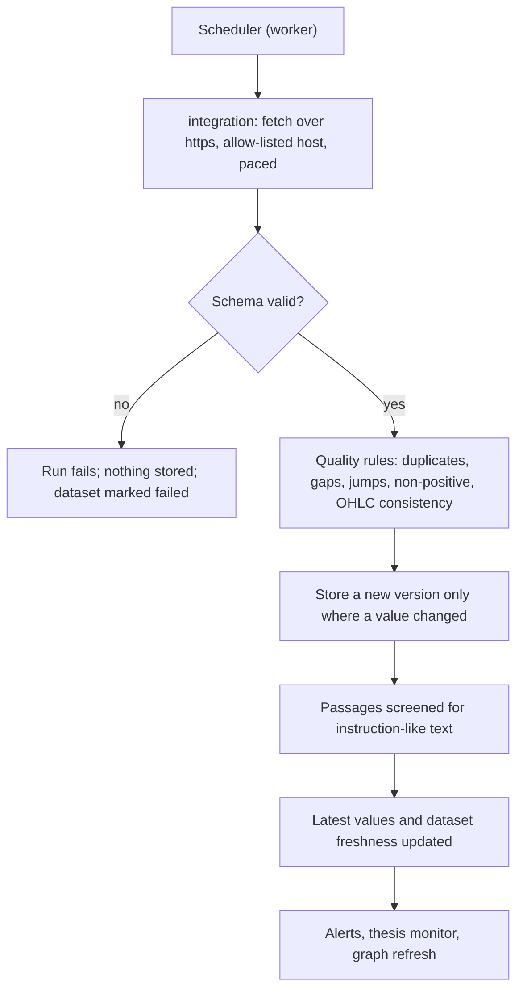
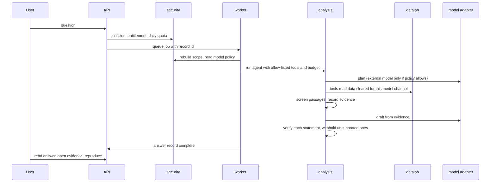

# Data flow

## Ingestion

- A batch is atomic: either every part passes validation or the run stores nothing.
- Quality rules never reject values; they set the status shown with them (`validated`, `suspect`, `demonstration`).
- `known_at` records when a value became known. Where the provider does not state it, a conservative
  publication lag is used (see data-sources.md), so point-in-time reads never see a value too early.
- Three consecutive validation failures from one connector raise a `SECURITY` log event.

## Research question

The request path is: schema validation (FastAPI/Pydantic) → identity → entitlements and limits →
module logic → output with provenance. Errors use one structure:
`{"error": {"code", "message", "details", "request_id"}}`.
